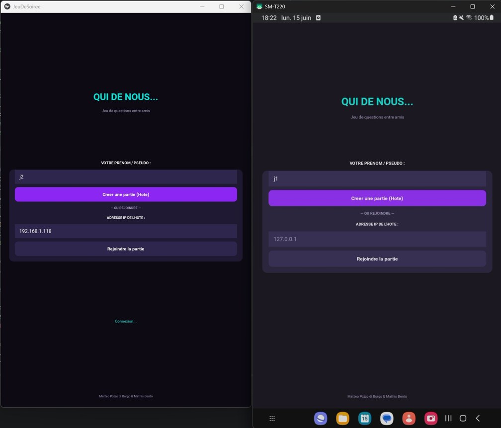
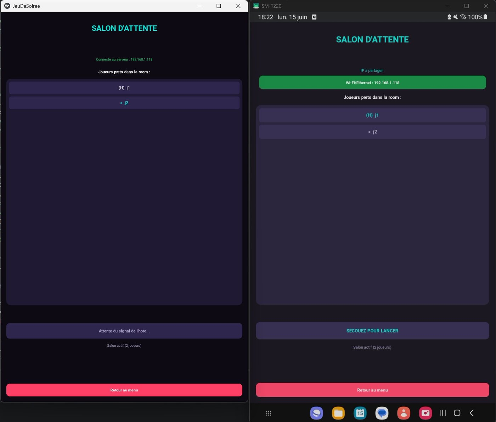
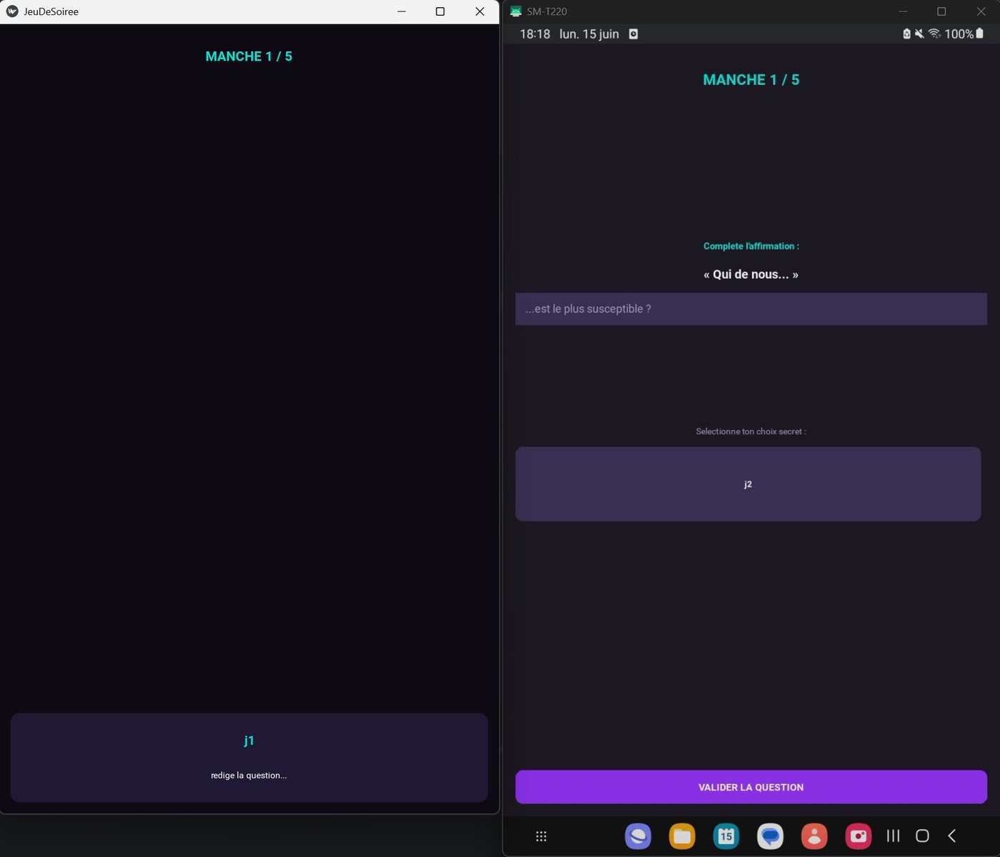
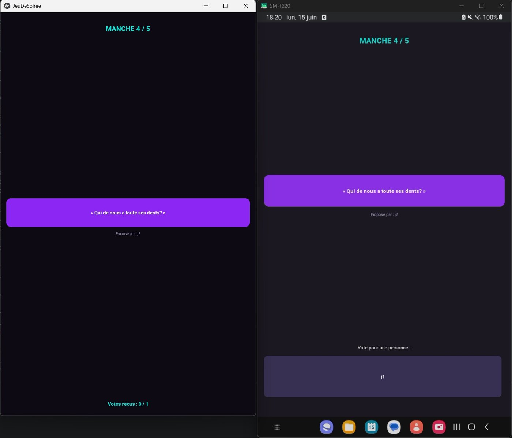
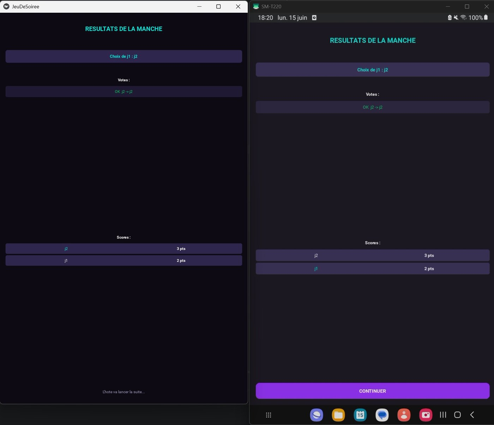
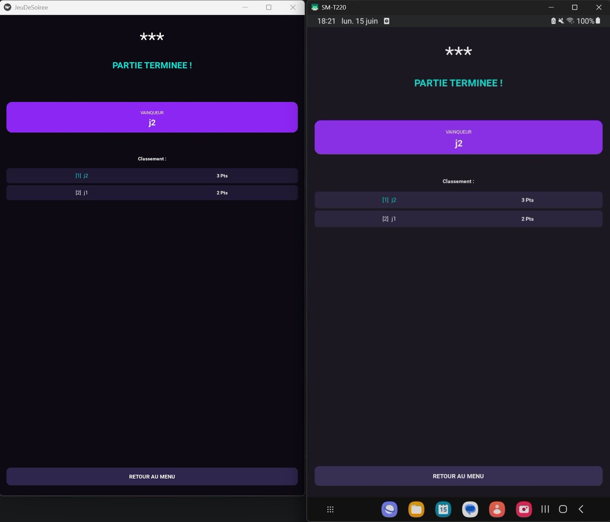
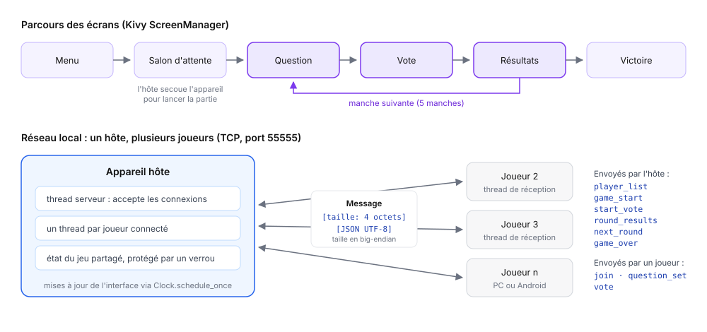

<p align="center">
  
</p>

# Qui de nous ? (QDN) — jeu de soirée en réseau local

Jeu de soirée multijoueur en **Python / Kivy**, sur **PC et Android** : un joueur héberge la partie, les autres la rejoignent depuis leur propre appareil sur le même Wi-Fi.

Mini-projet du cours AMC (Application Mobile et Capteurs) — 2e année de microtechnique (MT2), HEPIA (HES-SO Genève), 2026.



---

## Le jeu

À chaque manche, un joueur désigné complète la phrase **« Qui de nous… »** (par exemple *« …est le plus susceptible ? »*) et choisit secrètement la personne qu'il vise. Les autres joueurs votent pour la personne qu'ils pensent être la bonne réponse : chaque bonne réponse rapporte **1 point**.

Après **5 manches**, le joueur qui a le plus de points gagne et son nom s'affiche sur l'écran de victoire.

| | | |
|---|---|---|
|  |  |  |
| Menu : pseudo, créer ou rejoindre une partie | Salon d'attente : l'hôte secoue l'appareil pour lancer la partie | Le joueur désigné écrit la question et choisit sa cible secrète |
|  |  |  |
| Les autres joueurs votent | Résultats de la manche et scores | Fin de partie et classement |

## L'équipe

| Membre | Rôle |
|---|---|
| Mathis Bento | Architecture réseau (sockets TCP, protocole JSON), logique de jeu, détection de secousse |
| Mattéo Pozzo di Borgo | Design de l'interface, compilation Android (Buildozer), tests sur tablette, présentation |

## Lancer le jeu

### Sur PC

```bash
pip install kivy plyer numpy pygame psutil
python code/main.py
```

1. Entrer un pseudo.
2. **Créer une partie (Hôte)** pour héberger, ou entrer l'adresse IP affichée chez l'hôte puis **Rejoindre la partie**.
3. Dans le salon d'attente, l'hôte **secoue son appareil** pour lancer la partie, dès que deux joueurs au moins sont connectés.

Tous les appareils doivent être sur le **même réseau local**. La partie se lance uniquement par secousse : l'hôte doit donc être un appareil avec accéléromètre (téléphone ou tablette Android). Un PC peut rejoindre la partie comme joueur.

`numpy` et `pygame` servent uniquement au petit jingle de l'écran de victoire, et `psutil` à lister les adresses IP de l'hôte ; sans eux, le jeu fonctionne quand même.

> Le Wi-Fi de certains établissements, dont celui de HEPIA, isole les appareils les uns des autres (isolation AP) : les joueurs ne peuvent alors pas se connecter entre eux. Dans ce cas, utiliser un partage de connexion depuis un téléphone.

### Sur Android

L'application Android (APK) est disponible dans les [**Releases**](../../releases) du dépôt. Elle est compilée avec **Buildozer** à partir du dossier `code/` (`main.py`, `buildozer.spec`, `icon.png`).

Les chemins `android.sdk_path` et `android.ndk_path` de `buildozer.spec` correspondent à la machine virtuelle utilisée en cours : à adapter, ou à supprimer pour laisser Buildozer télécharger le SDK et le NDK.

Point important pour la compilation : la détection automatique des permissions de Buildozer ne repère pas l'utilisation des sockets. Sans la ligne suivante dans `buildozer.spec`, la connexion échoue avec `[Errno 1] Operation not permitted` :

```
android.permissions = INTERNET
```

## Fonctionnement



### Écrans

Six écrans gérés par un `ScreenManager` Kivy :

```
Menu → Salon → Question → Vote → Résultats → Victoire
```

La classe `G` centralise l'état partagé entre les écrans : joueurs et scores, sockets, manche en cours, question, réponse secrète et votes.

### Réseau

| Élément | Choix |
|---|---|
| Architecture | client / serveur sur le réseau local, l'hôte fait office de serveur |
| Protocole | TCP, port `55555` |
| Messages | JSON en UTF-8, précédés de leur taille sur 4 octets (big-endian) |
| Côté hôte | un thread serveur, plus un thread par joueur connecté |
| Côté joueur | un thread de réception |
| Concurrence | verrou `threading.Lock` sur les données partagées ; l'interface n'est mise à jour que depuis le thread principal, via `Clock.schedule_once` |

### Accéléromètre

Le capteur, lu avec `plyer.accelerometer`, sert à lancer la partie :
- il n'est actif que sur l'appareil hôte, dans le salon d'attente ;
- il est lu à 20 Hz, soit toutes les 50 ms ;
- une secousse est détectée quand |Δx| + |Δy| + |Δz| > 14,5 entre deux mesures ;
- sans capteur (sur PC), le salon affiche « Accéléromètre absent » et la partie ne peut pas être lancée depuis cet appareil.

## Limites connues

- La mise en page est fixe et s'adapte mal à certaines tailles d'écran.
- Les joueurs virtuels (bots), prévus pour les tests, n'ont pas été finalisés.
- La partie ne peut être lancée que depuis un appareil équipé d'un accéléromètre.

## Contenu du dépôt

```
code/   main.py : le jeu complet (Python / Kivy)
        buildozer.spec et icon.png : compilation de l'application Android
docs/   Cahier des charges, présentation finale, schéma d'architecture
media/  Logo et captures d'écran
```

## Licence

- Code (`code/`) : **MIT**
- Documents, logo et images : **CC BY-NC-SA 4.0**

Voir [`LICENSE`](LICENSE) et [`LICENSE-CC-BY-NC-SA-4.0.md`](LICENSE-CC-BY-NC-SA-4.0.md).

---

Portfolio de Mattéo Pozzo di Borgo : [p0770.github.io](https://p0770.github.io/projects/jeu-amc)
